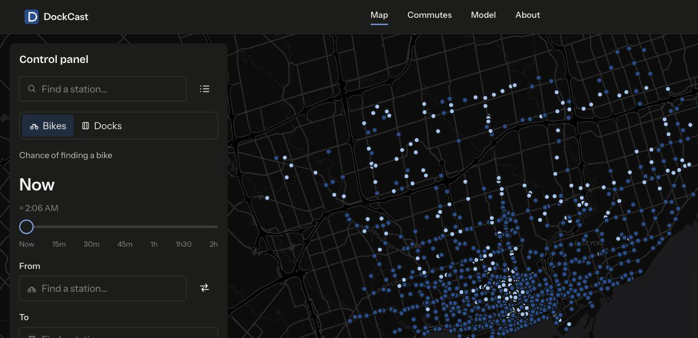
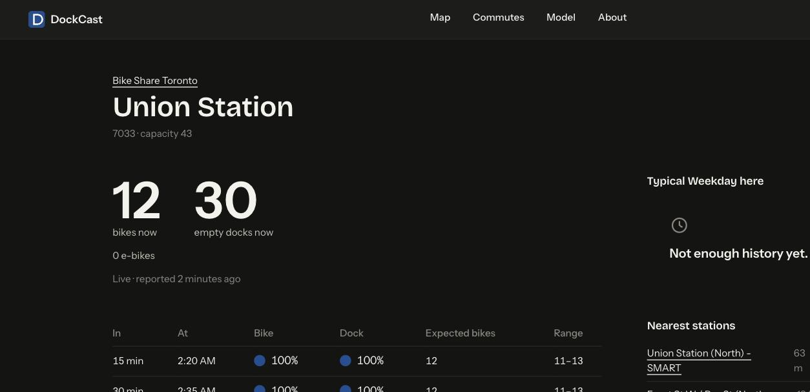
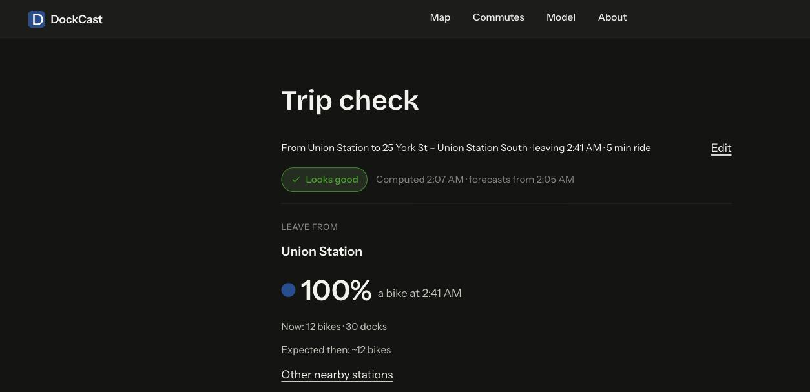
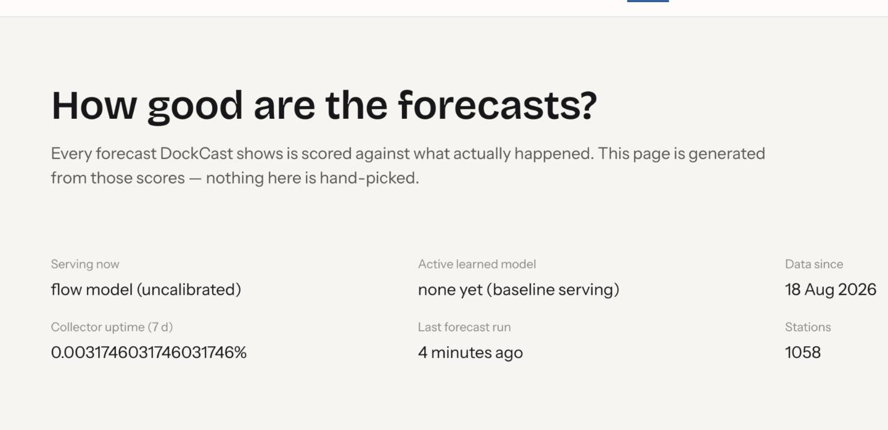
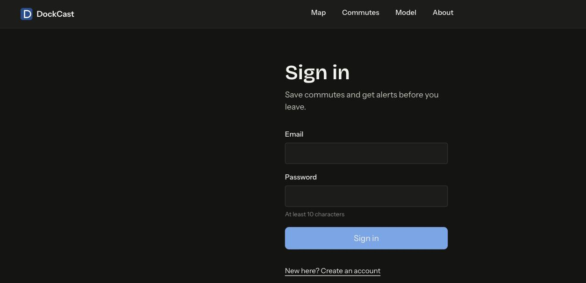

# DockCast

Forecasts bike-share station availability at the time you'll actually be there — not just what's happening right now.

## Screenshots

| Map | Station | Trip check |
|---|---|---|
|  |  |  |

| Model quality | Sign-in gate on `/commutes` |
|---|---|
|  |  |

## What it does

- Live map of a city's bike-share stations, colour-coded by the probability of finding a bike (or an empty dock) at a horizon you drag from *now* to *+2 h*.
- Trip check: pick an origin and destination station and a departure time, get a verdict ("Looks good" / "Risky" / "Don't count on it") plus nearby alternatives if the odds are bad.
- Per-station pages: current state, a 6-horizon forecast table, a 24 h history + forecast chart with an uncertainty band, and a typical-day profile.
- Saved commutes with a live outlook chip and optional web-push alerts before you leave, if the odds have dropped.
- A public model-quality page (`/model`) showing exactly how the forecasts are scoring against what actually happened — no hand-picked numbers.
- **No LLM or external inference anywhere in the load-bearing path.** All forecasting is in-house.

## How the forecast works

Full detail in [`docs/ml-spec.md`](docs/ml-spec.md); short version:

1. **Birth–death baseline (`bd`)**: each station is modelled as a finite-capacity queue — bikes arrive and leave at rates learned from a year of Toronto's own trip-history data, bucketed by station × day-type (weekday/Sat/Sun) × 15-minute-of-day, and scaled by a weather multiplier (temperature/precipitation) fit with a Poisson GLM. At forecast time, the transient distribution of the chain over the next 2 hours is computed exactly with a matrix exponential (`scipy.linalg.expm`), giving `P(≥1 bike)`, `P(≥1 dock)`, and an expected count at 15/30/45/60/90/120-minute horizons.
2. **Calibration**: once ≥14 days of predictor history exist, `bd`'s probabilities are passed through an isotonic regression fit on a rolling window, correcting for the baseline's over-confidence.
3. **Learned challenger (`gbm`)**: three pooled LightGBM models (bike/dock/count), trained nightly on our *own* forecast history joined to what actually happened, stacking the `bd` output as a feature alongside station state, time, weather, and neighbour context.
4. **Walk-forward validation + promotion gate**: the challenger is scored on held-out days against the flow-model baseline (Brier score, calibration, MAE) and only promoted to serve traffic if it beats the baseline on every metric; otherwise it stays a "shadow" model, scored but not served.
5. **Continuous online scoring**: every forecast made at a 15-minute grid origin is scored against the label that later materialises, and rolling 1-day/7-day metrics per tier feed the public `/model` page — the thing that would tell you if the champion model started degrading.

The API interpolates linearly between the two bracketing horizons for a user's arbitrary lead time; beyond 120 minutes it falls back to a "typical for this time of day" profile built from the last 4 weeks.

## Architecture

```
                ┌───────────────────────────── VPS (docker compose) ─────────────────────────────┐
                │                                                                                │
 GBFS feeds ──▶ │  collector (Node/TS)  ──writes──▶  ┌────────────────────────────┐              │
 Open-Meteo ──▶ │   60 s station_status              │  db: TimescaleDB + PostGIS │ ◀── reads ── │ ◀── browser
                │   30 min weather forecast           │  (Postgres 16)             │              │      (React SPA)
                │   1 h station_information            └────────────────────────────┘              │
                │                                         ▲          ▲        ▲                  │
                │  worker-predict (Python) ──writes forecasts_latest / forecast_history           │
                │   every 5 min                            │          │        │                  │
                │  worker-train (Python, nightly 03:30 local) ─ trains, gates, writes models     │
                │                                                                │                │
                │  api (Node/TS Express 5) ──reads/writes───────────────────────┘                │
                │   REST /api/v1, auth, commutes, alert scheduler, serves web build              │
                │                                                                                │
                │  caddy ── TLS, reverse proxy :443 → api:3000                                   │
                └────────────────────────────────────────────────────────────────────────────────┘
```

| Component | Stack | Responsibilities |
|---|---|---|
| `db` | Postgres 16 + TimescaleDB + PostGIS | all state; hypertables for snapshots, poll log, forecast history, labels |
| `collector` | Node 22, TypeScript | GBFS polling (60 s status, 1 h station info, 30 min weather), change-only writes |
| `worker` | Python 3.12, pandas/lightgbm/scipy/statsmodels | `bootstrap` (trip history → rates), `predict` loop, nightly `train` (calibrate, gate, score) |
| `api` | Node 22, Express 5 | REST API, session auth, commutes, trip check, web-push alert scheduler, serves the SPA |
| `web` | React 19, Vite 6, MapLibre GL, TanStack Query, Recharts, Tailwind v4 | the SPA |
| `caddy` | Caddy 2 | automatic HTTPS, reverse proxy, gzip/zstd |

## Data sources & licences

- **GBFS feed** — Bike Share Toronto (PBSC / Toronto Parking Authority), GBFS v3.0.
- **Trip history** — Toronto Open Data "Bike Share Toronto Ridership Data" (Open Government Licence – Toronto).
- **Weather** — [Open-Meteo](https://open-meteo.com) (CC BY 4.0, non-commercial free tier): archive API for training, forecast API for serving.
- **Basemap** — [OpenFreeMap](https://openfreemap.org) vector tiles / OpenMapTiles / © OpenStreetMap contributors.

## Run locally

**Dev** (apps on host, db in Docker):

```sh
pnpm install
docker compose -f infra/docker-compose.dev.yml up -d db db-test
cp .env.example .env
pnpm db:migrate
pnpm dev                                              # api :3000, web :5173, collector

cd ml && uv sync
uv run python -m dockcast_ml bootstrap --city toronto --from 2026-03 --to 2026-03
uv run python -m dockcast_ml predict --once
```

**Full stack** (everything in Docker, matches production images):

```sh
docker compose -f infra/docker-compose.yml --env-file infra/.env.local-smoke build
docker compose -p dockcast-smoke -f infra/docker-compose.yml --env-file infra/.env.local-smoke up -d
curl http://localhost/api/v1/health
docker compose -p dockcast-smoke -f infra/docker-compose.yml --env-file infra/.env.local-smoke run --rm worker-train \
  python -m dockcast_ml bootstrap --city toronto --from 2026-03 --to 2026-03
docker compose -p dockcast-smoke … down -v                    # cleanup
```

See [`docs/infra.md` §2](docs/infra.md#2-dev-compose--infradocker-composedevyml) and §12 for the full local-smoke-test workflow.

## Deploy

Single VPS, Docker Compose, Caddy TLS, GHCR images built by GitHub Actions on every push to `main`. Full runbook, secrets list, and backup/restore scripts: [`docs/infra.md`](docs/infra.md) §1, §6, §7, §8.

## Testing

```sh
pnpm -w lint && pnpm -w typecheck && pnpm -w test         # Node packages (needs DATABASE_URL_TEST)
cd ml && uv run ruff check . && uv run pytest -q          # Python
```

Current counts (all green):

| Package | Tests |
|---|---|
| `@dockcast/shared` | 104 |
| `@dockcast/db` | 8 |
| `@dockcast/collector` | 78 |
| `@dockcast/api` | 100 |
| `@dockcast/web` | 108 |
| `dockcast_ml` | 83 |

## Honest limitations

- **Rebalancing (operator vans) is unmodelled** in the flow baseline; the learned model is expected to partially pick it up once enough data exists.
- **Trip-history rates are annual averages** — they correct for weather but not for secular ridership growth (e.g. a station that gets busier month over month).
- **Poisson over-dispersion is handled post-hoc** by calibration, not by the underlying process model.
- **Special events** (parades, closures, construction) will be wrong; that's inherent to a model with no event calendar.
- **The learned model needs real predictor history to train** (`forecast_history` joined to `forecast_labels`, ≥14 local days) — on a fresh deployment it correctly reports `insufficient_data` until then, and only the flow-model baseline serves.
- **The alert scheduler assumes a single API replica** (documented, not addressed for v1).
- Full list: [`docs/ml-spec.md` §9](docs/ml-spec.md).

## Docs

| Doc | What's in it |
|---|---|
| [`architecture.md`](docs/architecture.md) | System design, component table, cross-cutting rules |
| [`ml-spec.md`](docs/ml-spec.md) | The forecasting model, in full — data, math, training, gating, metrics |
| [`api.md`](docs/api.md) | HTTP API contract, every endpoint and DTO |
| [`ui-spec.md`](docs/ui-spec.md) | Frontend spec — design system, routes, components |
| [`collector-spec.md`](docs/collector-spec.md) | GBFS polling behaviour |
| [`worker-spec.md`](docs/worker-spec.md) | Python worker module layout and CLI |
| [`infra.md`](docs/infra.md) | Docker Compose, deploy runbook, backups, monitoring |
| [`plan.md`](docs/plan.md) | Implementation plan and work packages (how this was built) |

## No LLMs

Every forecast is computed by the models described above, from open data DockCast collects and processes itself. No calls to any LLM or external inference API are on the load-bearing path anywhere in this app.
